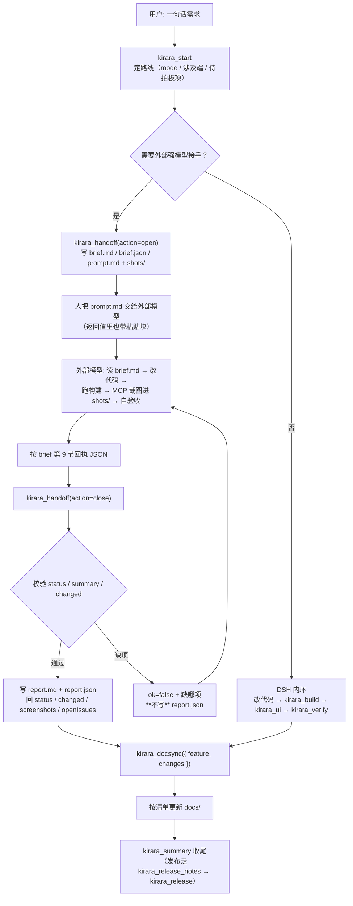

# 外部强模型交接（`kirara_handoff`）

分工开发时，同一条需求要在**两个不共享上下文的智能体**之间传两遍：

| 阶段 | 谁做 | 产出 |
| --- | --- | --- |
| 1 | DSH（本插件） | 需求解读、路由判定、检索文档、产出**交接包**（brief） |
| 2 / 3 | 外部强模型（有 MCP 的编码智能体） | 改代码、跑构建、用 MCP 实时视觉迭代、自验收、产出**回执**（report） |
| 4 | DSH（本插件） | 收回执、文档同步、发布、总结 |

靠聊天记录转述这件事有个必然的衰减：第二次转述和第一次不一样，而外部模型那边**没有任何办法
发现自己少读了一条约束**。所以 `kirara_handoff` 把交接的两端都落成文件，用路径而不是记忆传递。

## 流程图



两条链在文档同步处合流：**谁改的代码不影响文档要不要同步**，但「改了哪些文件」只有回执能提供 ——
这也是 `close` 必须回出 `changed[]` 的原因。

## 交接目录

```text
<workspaceRoot>/.kirara-dev/handoff/<runId>/
├── brief.md      # 人读的交接包（九节）
├── brief.json    # 机读的同一份（targets / docHits / safety / checklist）
├── prompt.md     # 可直接粘贴给外部模型的那段话（约 900 字）
├── shots/        # 外部模型的截图（双方都能看到的唯一证据目录）
├── report.md     # close 时写入（回执原文，一字不改）
├── report.json   # close 时写入（解析 + 校验后的结构）
└── README.txt    # 一行说明：这是交接目录，别删
```

- `runId` 形如 `KH-20261127-1807`（本地时间）；同一分钟内连续 `open` 会补 `-2` / `-3`，
  **不覆盖**旧目录（`scripts/handoff-test.mjs` 有断言）。
- 根目录默认 `<workspaceRoot>/.kirara-dev/handoff`，可用 `handoffDir` 覆盖。
- 插件**不改**用户仓库的 `.gitignore`（那有副作用，而且会出现在别人的 diff 里）：
  需要忽略时由用户自己加，插件只在目录里放 `README.txt` 说明来历。

## brief 的九节

每节都必须是**有内容**的，不允许只留标题（夹具按「节与节之间的正文长度」断言）。

| # | 章节 | 写什么 | 数据来源 |
| --- | --- | --- | --- |
| 1 | 任务卡 | runId、生成时间、需求原文、mode 与判定依据、需人拍板的点 | `resolveRoute()` |
| 2 | 你的边界 | 可做（改代码 / 跑构建 / 截图 / 用 MCP）；不可做（改技术文档 / 发版 / 改版本号 / 改插件 / 扩大范围）；`SAFETY_RULES` 原样 | 固定文案 + `SAFETY_RULES` |
| 3 | 涉及端 | key、标题、仓库目录、技术栈、构建命令、产物、iOS 版本锁 | `findProject` / `buildLineFor` |
| 4 | 必读事实 | 该端 `constraints` **全量**；iOS 相关时挑 3 条 `pitfalls`（按需求词命中排序） | `PROJECTS[].constraints` / `.ios.pitfalls` |
| 5 | 代码定位线索 | 建议先读的文档（≤4 篇/端），并明说单篇最大 258 KB、按小节读 | `docsForProject()` |
| 6 | 文档片段 | 按需求关键词检索出的命中行（≤5 条、每条 ≤180 字符、带 `文件:行号`） | `searchDocScopes()` |
| 7 | 验收标准 | 构建命令 + 期望 exit 0；UI 改动时的视觉环要求（截哪些状态）；行为验收项 | 由 `mode` / `uiChange` 推导 |
| 8 | MCP 用法 | 按端给：桌面（UI 自动化 MCP / pwsh+截图）、Android（adb）、iOS（Xcode MCP / simctl）、API（不需要截图）；末尾统一写「没有就写不可用，**不要假装**」 | 静态文案 |
| 9 | 回执格式 | 回执 JSON 契约 + 校验规则 + 「截图写进 `shots/`」 | `REPORT_SPEC` |

两条刻意的设计：

- **第 8 节不写具体工具名。** 那台机器上装了什么 MCP 是运行时事实，写死等于教外部模型调用一个
  可能不存在的工具（然后它会在回执里编造截图）。所以只描述**能力**（截图 / 点按 / UI 树）与兜底路径，
  再统一要求「没有就明说」。
- **第 6 节宁缺毋滥。** 命中的是**行**而不是整节；5 条就够定位，多给只会把 brief 撑大。

## 回执契约

`close` 接受两种形态：整段就是 JSON，或包在 ` ```json ` 围栏里。

```json
{
  "runId": "KH-20261127-1807",
  "status": "done | partial | blocked",
  "summary": "一句话说清做了什么",
  "changed": [{ "file": "Kirara_Media/app/src/main/java/.../SettingsScreen.kt", "why": "为什么改" }],
  "commands": [{ "cmd": "gradlew assembleDebug", "exit": 0, "note": "48s" }],
  "screenshots": [{ "path": "shots/shot-01.png", "state": "设置页-深色", "note": "改后" }],
  "verification": {
    "build": "ok | failed | skipped",
    "uiLoop": "closed | open | n/a",
    "acceptance": [{ "item": "...", "result": "pass | fail", "evidence": "..." }]
  },
  "docsHint": ["SettingsScreen 的默认值变了，需更新 11.2 小节"],
  "openIssues": [],
  "blockedBy": null
}
```

校验规则（`handoffCheckReport()`）：

| 规则 | 行为 |
| --- | --- |
| `status` 不在 `done` / `partial` / `blocked` | 拒收，`ok:false`，`missing` 里点名 |
| `summary` 为空 | 拒收 |
| `changed` 不是数组 | 拒收 |
| 拒收时 | **不写** `report.json`（半份结构写下去，下一步的文档同步会拿它当事实） |
| `changed[].file` | 原样保留（不改斜杠、不加前缀），直接作为 `close` 返回值的 `changed[]` 喂 `kirara_docsync` |
| `screenshots[].path` | 相对 `shots/` 解析并 `stat`；不存在的列进 `missingScreenshots`；越界标 `outside`（不 stat 到目录外） |
| `commands[].exit` | 只在真的是数字时保留（字符串 `"0"` 会让「退出码 0」看起来通过而实际没跑） |

`close` 的返回值里，`changed[]` 是**字符串数组**（文件路径），不是对象数组——
因为它的下一个消费者是 `kirara_docsync({ changes })`，那里要的就是路径。

## 失败处理：外部模型只回了一半怎么办

这是最常见的失败，而且**不能靠「再问它一次」解决**（那等于把同一个不确定性再赌一遍）。
按回执的形态分四种处理：

| 现象 | 判定 | 处理 |
| --- | --- | --- |
| 一整个糊在 Markdown 里、没有 JSON | 解析失败 | `close` 返回 `ok:false` + 「没有可解析的 JSON 对象」。把 brief 第 9 节的契约片段贴回去，让它**只补 JSON**，不要重做实现 |
| 有 JSON 但缺 `status` / `summary` / `changed` | 结构不合格 | `ok:false` + `missing` 点名。`report.json` 不会写，所以不会污染后续链路 |
| 结构齐但 `status: "partial"` | 合法的半成品 | 照收。`close` 会把 `openIssues` / `blockedBy` 带出来，`nextStep` 明说「别把半成品当完成」；文档同步只按**真实改动**走 |
| 结构齐但 `status: "blocked"` | 合法但没做完 | 照收。先处理 `blockedBy`（通常是缺设备 / 缺 MCP / 缺权限），决定是补环境重开一轮还是改由 DSH 内环做 |
| 声称 `done` 但截图不存在 | 证据不足 | 照收（不静默丢），`missingScreenshots` 列出缺的那几张，`nextStep` 明写「视觉证据不完整」。**不要**替它补一张图 |

三种「必须重开一轮」的情况（不要在旧 run 上硬改）：

1. 需求本身变了（`mode` 或涉及端变了）⇒ 重新 `open`，拿新的 brief；
2. 外部模型改了 brief 之外的东西（越界改 `docs/`、改版本号）⇒ 回执保持原样，但 `openIssues` 里
   必须写清越界内容，由 DSH 侧决定是否回滚；
3. 交接目录被删了 ⇒ `close` 会明确报「run 目录不存在」，不要凭空造一份 report.json。

## 与既有链路的关系

- `kirara_start`：`kirara_route` 已并入它（`detail="route"`），两者与 `kirara_handoff(open)` 共用
  `resolveRoute()` —— **同一个需求在任何入口得到同一个 mode**，这是删掉 `kirara_route` 的真正理由
  （两个入口 = 两套判定 = 必然漂移）。
- `kirara_docsync({ feature, changes })`：`close` 回出的 `changed[]` 直接喂它；
  回执里的 `docsHint` 是一句「哪里要同步」的人话提示，**不是**文档改动本身。
- `kirara_summary`：`close` 的 `nextStep` 固定写成「先 docsync 定文档，再写，最后 summary」。
- `kirara_release` / `kirara_release_notes`：发版仍在 DSH 侧 —— 外部模型不碰版本号与产物。
- 不新增任何「外部模型管理」工具：没有轮询、没有网络请求、没有任务队列。
  文件在磁盘上，人和工具都能看，这就是全部机制。

## 预算与安全

- `open` 的返回值：`inline=false` 时只有路径 + 可粘贴的 prompt（**≤2400 字符**）；
  `inline=true` 时再加 brief 正文（**≤ `handoffBudgetChars`**，默认 6000，截断提示也计入预算）。
- 工具名 / `description` / `parameters` 是启动即固定的字面量：`runId`、时间、目录只出现在返回值里。
  `kirara_handoff` 自己占 889 字节常驻前缀；减去被删掉的 `kirara_route`（−620）后净增 402 字节，
  工具目录只剩 45 字节余量（见 README）。
- `report` 是**外部输入**：只做结构校验与落盘，里面的任何字符串都不会被拼进命令行执行。
- 落盘路径 `resolve` 后必须仍在 `handoffDir` 之内；`runId` 用严格正则 + 二次校验，
  `../../x` 这种形态连目录都不会被创建。
